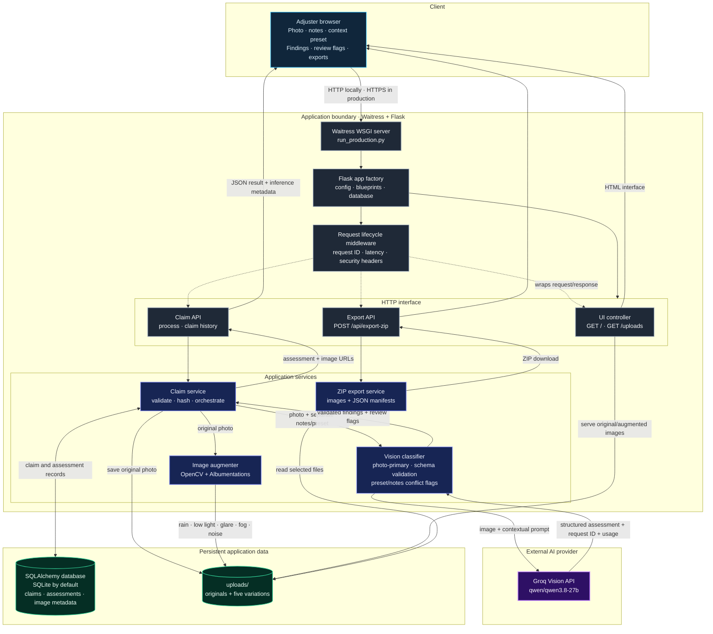

# ClaimAugment AI

**Photo-first vehicle-damage triage and evidence-augmentation workspace**

ClaimAugment AI accepts a vehicle damage photo, compares the visible damage with optional adjuster notes and a selected context preset, and returns a structured AI-assisted assessment. It can also generate environmental image variations for dataset experimentation and keep a local claim history.

> **Decision-support notice:** This project is a prototype triage aid, not an insurance appraisal, repair quote, or coverage decision. Model confidence is an estimate, not a calibrated probability. An adjuster must verify the image, findings, and any cost estimate before acting.

## What it does

- Analyzes uploaded vehicle photos with a Groq vision model.
- Treats the photo as primary evidence; notes and presets are context, not ground truth.
- Flags conflicts such as severe visible door deformation paired with the **Door Scratch** preset.
- Shows visible findings, estimated damage type and severity, suggested next action, and whether adjuster review is recommended.
- Reports the Groq model, request ID, and token counts after successful inference.
- Produces five local image variations: rain, low light, glare, fog, and sensor noise.
- Records claims, assessment summaries, image hashes, and augmentation metadata in SQLAlchemy.
- Exports selected image files and a JSON report as a ZIP archive.

The three buttons in the interface—**Frontal Collision**, **Door Scratch**, and **Hail & Glass**—are context presets, not three separate classifiers. Selecting a preset does not overwrite the adjuster notes.

## Product intent

The intended user is an adjuster or claims-operations reviewer who needs an initial, evidence-linked triage view—not an automated settlement. The workflow is designed to make visible damage easier to inspect, surface disagreement between the photo and claim context, and produce consistent image variants for experimentation.

The value is in **faster structured review and clearer handoff**, not replacing a licensed inspection, repair estimate, or coverage decision.

## Architecture at a glance



**Solid arrows** show runtime data flow. The dotted middleware edge represents cross-cutting request/response behavior.

The uploaded image is sent to Groq as image input. The app checks the returned JSON against allowed damage types, severities, actions, and components. Invalid model output or provider errors produce an explicit error response; they are not replaced with a made-up successful assessment.

The illustrative repair estimate uses the fixed parts and labor values in [`modules/classifier.py`](./modules/classifier.py). It is not a shop quote. The legacy `total_loss_probability` response field is displayed in the UI as a **cost-to-$14,000-reference ratio**, not a statistically calculated probability.

## Technology

| Area | Implementation |
|---|---|
| Web application | Flask |
| Database | Flask-SQLAlchemy; SQLite by default |
| Vision inference | Groq Chat Completions, default model `qwen/qwen3.8-27b` |
| Image augmentation | OpenCV and Albumentations |
| Image input/output | Pillow |
| Production WSGI server | Waitress |
| Optional temporary public tunnel | ngrok via `pyngrok` |

## Quick start (Windows PowerShell)

Use an installed Python interpreter. If the `py` launcher is unavailable, use `python` as below. If you already have the project’s `venv` activated, you can skip creating and activating `.venv`.

```powershell
python -m venv .venv
.\.venv\Scripts\Activate.ps1
python -m pip install -r requirements.txt
Copy-Item .env.example .env
notepad .env
```

In `.env`, set a real Groq API key:

```dotenv
GROQ_API_KEY=your_real_groq_api_key
GROQ_VISION_MODEL=qwen/qwen3.8-27b
PORT=5050
SECRET_KEY=replace_with_a_long_random_secret
```

The default vision model was verified against Groq and used for an image inference test. Model access and availability can change; confirm the selected model is enabled for your Groq account. Keep `.env` private and never paste the API key into source code or commit it.

Start the Waitress server:

```powershell
python run_production.py
```

Open [http://localhost:5050](http://localhost:5050). Stop the server with **Ctrl+C**.

For local development only, `python app.py` starts Flask's development server. Do not expose that server publicly.

## Configuration

| Variable | Required | Default | Purpose |
|---|---:|---|---|
| `GROQ_API_KEY` | Yes for classification | — | Secret used for Groq inference. |
| `GROQ_VISION_MODEL` | No | `qwen/qwen3.8-27b` | Vision model identifier. |
| `PORT` | No | `5050` | Port used by the production server and tunnel. |
| `SECRET_KEY` | Recommended | Random per process | Flask secret. Set a stable secret for deployments. |
| `DATABASE_URL` | No | `sqlite:///claimaugment.db` | SQLAlchemy connection string. With Flask-SQLAlchemy, the default SQLite file is under `instance/`. |
| `UPLOAD_FOLDER` | No | `<project>/uploads` | Directory for originals and generated images; Render sets this to `/var/data/uploads`. |
| `NGROK_AUTH_TOKEN` | Only for ngrok | — | Auth token used by `python tunnel.py`. |
| `DEBUG` | Development only | `True` in `app.py` | Controls Flask's development server; `run_production.py` uses Waitress instead. |

An example configuration is provided in [`.env.example`](./.env.example). Copy it once; if `.env` already exists, edit it rather than overwriting it.

## API

All JSON responses use a `status` field. Request middleware adds `X-Request-ID` and `X-Response-Time` headers.

### `POST /api/process-claim`

Submit `multipart/form-data`:

| Field | Required | Description |
|---|---:|---|
| `photo` | Yes | Vehicle photo (`jpg`, `jpeg`, `png`, or `webp`), maximum 16 MiB. `file` is accepted as an alias. |
| `notes` | No | Adjuster-provided observations. Treated as context and checked against the photo. |
| `preset` | No | One of `frontal_collision`, `door_scratch`, or `hail_glass`. |

Successful responses contain `data.ai_assessment` with classification, visible findings, mismatch/review flags, an illustrative financial breakdown, and an `inference` object. The inference object includes the provider, model, request ID, and prompt/completion token counts. Use the request ID as per-call evidence that Groq returned a response; check Groq Console under the same organization/project as the API key for account-level usage.

Example request (PowerShell):

```powershell
curl.exe -X POST http://localhost:5050/api/process-claim `
  -F "photo=@C:\path\to\damage-photo.jpg" `
  -F "preset=door_scratch" `
  -F "notes=Reported as a superficial scratch; please verify against the photo."
```

Typical errors include `400` for a missing photo or unsupported file extension, `413` for an oversized request, `503` when vision inference is unavailable or rate-limited, and `500` for other processing failures (including an unreadable image). Rate-limited calls are surfaced for retry; the app does not silently substitute an assessment.

### `GET /api/claims`

Returns up to the 50 most recent stored claims.

### `GET /api/claims/<claim_id>`

Returns a claim by UUID or claim number. Stored history includes the assessment summary and review note, but does not persist the full Groq request metadata.

### `POST /api/export-zip`

Accepts JSON containing an `images` array and optional `ai_assessment`; returns a ZIP containing available image files and JSON manifests.

### Other routes

- `GET /` — application UI.
- `GET /healthz` — readiness endpoint used by Render; confirms the database can answer a query.
- `GET /uploads/<filename>` — serves uploaded and generated image files.

## Verify Groq and inspect a result

Run the smoke test with a local damage image:

```powershell
python test_classifier.py "C:\path\to\damage-photo.jpg"
```

This makes **one live Groq inference request**. It prints the assessment, visual findings, preset conflict/review status, request ID, and token usage. A successful response with a request ID is immediate per-call confirmation; automated tests use mocked inference and do not consume Groq requests.

In the web UI, a successful claim shows the same request ID and token counts below the visible findings. If the console's aggregate count appears unchanged, verify that it is showing the same Groq organization/project and API key configured in `.env`, and that the request completed successfully rather than returning an error.

## Tests

Run the local test suite without making live Groq inference calls:

```powershell
python -m pytest tests test_api.py -q
```

Vision-classifier tests mock the Groq client and cover severe door damage versus the Door Scratch preset, review signaling, invalid model output, and missing photos. The HTTP integration test also mocks Groq and uses an isolated in-memory database.

## Deploy to Render

The repository includes [`render.yaml`](./render.yaml), a Render Blueprint for a Waitress web service with a persistent disk. Render assigns a public `onrender.com` URL after the first successful deployment.

> **Cost and plan:** Render's persistent disks are available on paid web services; the service in `render.yaml` requests a 1 GB disk. Review Render's current service and disk pricing before provisioning. Without persistent storage, local SQLite data and uploaded claim images are lost on restart or deploy.

### 1. Push the project to GitHub

Create a GitHub repository and push the project to it. Do not commit `.env`, API keys, claimant images, local database files, or virtual environments. Check that the existing `.gitignore` exclusions are in effect before pushing.

### 2. Create the Render service from the Blueprint

1. Sign in at [dashboard.render.com](https://dashboard.render.com).
2. Select **New → Blueprint** and connect the GitHub repository containing `render.yaml`.
3. Review the proposed service and disk. Choose a region near your users and check the current price before applying.
4. When prompted for `GROQ_API_KEY`, enter the key through Render's secret/environment-variable UI. Do not put it in `render.yaml` or Git.
5. Apply the Blueprint and wait for the build and deploy to finish.

The Blueprint configures:

| Setting | Render value |
|---|---|
| Build command | `pip install -r requirements.txt` |
| Start command | `python run_production.py` |
| Health check | `GET /healthz` (checks that the database responds) |
| Persistent mount | `/var/data` |
| SQLite database | `/var/data/claimaugment.db` |
| Uploaded and generated images | `/var/data/uploads` |
| Secret | Render-generated `SECRET_KEY` |
| Vision model | `qwen/qwen3.8-27b` |

Render supplies `PORT` at runtime; Waitress binds to `0.0.0.0` and uses that value.

### 3. Verify the public deployment

Copy the service's **onrender.com** URL from the Render dashboard and open it in a browser. Check the health endpoint:

```powershell
curl.exe -i https://YOUR-SERVICE.onrender.com/healthz
```

It should return HTTP `200` with `{"status":"ok"}`. Then submit a **non-sensitive test photo** through the UI and confirm the page displays the assessment and Groq request ID. In the Render logs, confirm the service starts successfully and completes the request. Test persistence by checking the claim and image after a normal redeploy.

If deployment fails, inspect the Render **Events** and **Logs** pages. Common issues are a missing/invalid `GROQ_API_KEY`, dependency build failure, an unhealthy `/healthz`, or a mismatch between the mount path and `DATABASE_URL`/`UPLOAD_FOLDER`.

### Storage and scaling limitations

- Both SQLite and uploads are stored under the same persistent disk, so the disk must remain attached to the service.
- SQLite on a persistent disk is intended for a single service instance and modest demo traffic. It is not a multi-instance database; use managed PostgreSQL and object storage before horizontal scaling or handling substantial production workloads.
- Back up the SQLite database and uploaded files. Render disk persistence protects data across normal deploys/restarts but is not a complete backup strategy.
- `db.create_all()` creates missing tables but does not migrate existing schemas. Back up the database and use an explicit migration process when changing models.
- `python tunnel.py` remains an option for a temporary ngrok demo, but it does not provide durable hosting.

## Security and operational notes

- The project currently has no user authentication or authorization. Do not expose claim endpoints or uploaded images to the public internet without adding access control.
- Uploaded claim photos are sensitive. They are stored under `uploads/` and sent to Groq for vision inference; confirm your privacy, retention, and consent requirements before using real claimant data.
- `.env` and `uploads/` are excluded by `.gitignore`. Keep secrets and claimant images out of version control.
- Groq rate limits apply to the account/model. The app returns a service-unavailable error when rate-limited; it does not yet queue requests or automatically retry them.
- Model output and confidence are fallible. Review visual findings, especially when `review_recommended` is true or the photo is unclear.

## Repository map

```text
app.py                      Flask application factory and configuration
controllers/                UI and JSON API routes
services/                    Claim processing and ZIP export
modules/classifier.py        Groq Vision classification and estimate calculation
modules/augmenter.py         Local environmental image transformations
models.py                    Claim, assessment, and image database models
templates/index.html         Web interface and client-side behavior
static/                      Styles and frontend assets
tests/                       Isolated application and vision-classifier tests
run_production.py            Waitress production entry point
render.yaml                  Render Blueprint with persistent storage
tunnel.py                    Optional temporary ngrok tunnel
```
